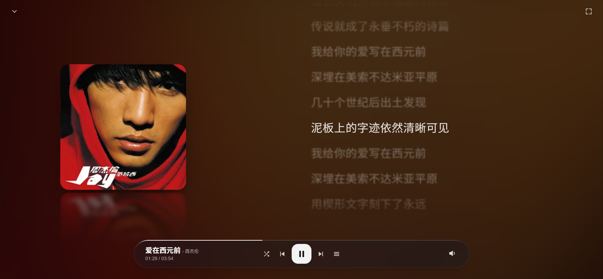

# Refrain



一个基于 [APlayer](https://github.com/DIYgod/APlayer) 和 [MetingJS](https://github.com/metowolf/MetingJS) 的静态音乐播放器。

> 本项目基于 [zhheo/HeoMusic](https://github.com/zhheo/HeoMusic)（Apache 2.0）大幅修改而来，保留原项目的核心播放能力，并重构了界面与本地音乐库。

## 基本操作

`Space空格键`：暂停/播放音乐

`上/下方向键`：增加/减少音量

`左/右方向键`：上一曲/下一曲

`ESC键`：在播放页与音乐库之间切换

## 修改歌单/私有部署与配置

### 使用URL参数（推荐）（适用于在线音乐）

Refrain 支持 URL 参数 `/?id=` + id + `&server=` + server（部署到你自己的域名后使用）

例如：

**示例歌单:** https://你的域名/?id=2762963245&server=netease

在线音乐模式歌单 ID 的解析由 [js/Meting.js](js/Meting.js) 内置的默认Meting API接口完成： `https://music.zhheo.com/meting-api/`。

### 修改配置文件（适用于在线音乐和本地音乐）

将`config.js.demo`文件重命名为`config.js`，并修改其中的配置

直接访问首页`index.html`即可

#### ID

播放列表的id，可以从音乐歌单分享的链接中获取，例如`https://y.qq.com/n/ryqq/playlist/8668419170`中，id为`8668419170`

#### Server

播放列表的服务商，例如`netease`（网易云音乐）,`tencent`（腾讯）,`kugou`（酷狗）,`xiami`（小米音乐）,`baidu`（百度音乐）

#### Type（可选）

播放列表的类型，例如`song`（单曲）, `playlist`（歌单，默认）, `album`（专辑）, `search`（搜索结果）, `artist`（歌手）

#### localMusic（可选）

本地音乐/外链音乐。如果填写了本地音乐，则优先使用本地音乐。

本地音乐需要添加loaclMusic数组，它的形式类似于：

```
  var localMusic = [{
      name: '重生之我在异乡为异客',
      artist: '王睿卓',
      url: '/music/重生之我在异乡为异客.mp3',
      cover: '/music/重生之我在异乡为异客.png',
      lrc: '/music/重生之我在异乡为异客.lrc'
  },
  {
      name: '落',
      artist: '唐伯虎',
      url: '/music/落.mp3',
      cover: '/music/落.png',
      lrc: '/music/落.lrc'
  }
  ];
```

#### remoteMusic（可选）

使用json格式的链接来进行读取localMusic，会覆盖localMusic的设置。

例如：

```
var remoteMusic = './music.json';
```

musicjson内容例如：

```
[
  {
    "name": "重生之我在异乡为异客",
    "artist": "王睿卓",
    "url": "/music/重生之我在异乡为异客.mp3",
    "cover": "/music/重生之我在异乡为异客.png",
    "lrc": "/music/重生之我在异乡为异客.lrc"
  },
  {
    "name": "落",
    "artist": "唐伯虎",
    "url": "/music/落.mp3",
    "cover": "/music/落.png",
    "lrc": "/music/落.lrc"
  }
]
```

## 本地音乐库数据文件

本地音乐模式（音乐库的歌曲 / 专辑 / 艺术家三个板块）依赖下面两个 JSON 数据文件。两者都已在 `.gitignore` 中，**不会随仓库发布**，需要自行创建。

### music-list.json（本地模式必需）

扁平的歌曲数组，通过 `config.js` 的 `remoteMusic` 指向（读取时会自动附加时间戳，避免浏览器缓存旧文件）：

```
[
  {
    "name": "Airport Arrival",
    "artist": "陶喆",
    "url": "/music/陶喆/1997-陶喆同名专辑/陶喆 - Airport Arrival.flac",
    "cover": "/music/陶喆/1997-陶喆同名专辑/cover.jpg",
    "lrc": "/music/陶喆/1997-陶喆同名专辑/陶喆 - Airport Arrival.lrc",
    "album": "1997-陶喆同名专辑"
  }
]
```

| 字段 | 必填 | 说明 |
|---|---|---|
| `name` | 是 | 歌名 |
| `artist` | 是 | 歌手；多位歌手用 `、` `，` `,` 分隔，音乐库会拆分成多个艺术家 |
| `url` | 是 | 音频地址，本地相对路径或外链均可 |
| `cover` | 否 | 封面图地址 |
| `lrc` | 否 | 歌词文件地址 |
| `album` | 否 | 专辑 key；缺省时取 `url` 的父文件夹名，再缺省归入「未知专辑」 |

专辑 key 建议写成 `年份-专辑名`（如 `1997-陶喆同名专辑`）：音乐库会把开头的四位年份解析出来单独显示，列表里只展示去掉年份后的专辑名。

### music-meta.json（可选）

为音乐库补充艺术家头像与专辑封面；文件缺失或请求失败时静默忽略，不影响播放：

```
{
  "artists": {
    "陶喆": { "pic": "https://example.com/artist.jpg" }
  },
  "albums": {
    "1997-陶喆同名专辑": { "pic": "https://example.com/album.jpg" }
  }
}
```

- `albums` 的 key 必须与 `music-list.json` 里的 `album` 字段（或缺省推导出的父文件夹名）**完全一致**
- 专辑封面回退链：`music-meta.json` 的 `pic` → 自动取该专辑第一首歌的 `cover` → 留空
- 艺术家头像回退链：`music-meta.json` 的 `pic` → 其第一张专辑的封面 → 留空

## 封面 / 歌词自动补全（三级兜底）

每首歌的封面与歌词按下面的顺序取值，前一级拿不到才走下一级（实现在 [js/localEngine.js](js/localEngine.js)，音乐库侧的同步逻辑在 [js/library.js](js/library.js)）：

1. **数据文件里的外链** —— `music-list.json` 的 `cover` / `lrc` 字段，或 `music-meta.json` 的专辑 `pic`
2. **音频内嵌标签** —— 用 `Range` 请求只读文件头尾，解析 FLAC 的 `VORBIS PICTURE` / `METADATA_BLOCK` 与 MP3 的 ID3v2 `APIC` / `USLT`；封面提取成功后会回写音乐库，专辑页、歌曲行、卡片和底栏一并刷新
3. **QQ 音乐接口识别** —— 按「歌名 + 歌手」搜索匹配，用命中的 `albummid` 拼封面图地址、用 `songmid` 取歌词（base64 解码后校验是否为合法 LRC）

### 第三级依赖的接口代理

浏览器直连 `c.y.qq.com` 会被 CORS 拦住，且无法携带必需的 `Referer`，因此第三级通过一个腾讯云 EdgeOne 边缘函数代理转发，函数源码在 [edge/qq-proxy/edge-functions/qq/index.js](edge/qq-proxy/edge-functions/qq/index.js)。

- **路由**：`/qq`，参数 `act=search&w=关键词`、`act=lyric&songmid=xxx`、`act=probe`（自诊断，返回两种签名前缀的上游响应）
- **改歌名歌手不匹配时**：匹配策略（歌名归一化 + 歌手交集）在 `localEngine.js` 的 `qqPick` 里
- **部署**：装好 EdgeOne CLI 后，在 `edge/qq-proxy` 目录执行 `edgeone makers deploy . -n <项目名> --json`；函数必须放在 `edge-functions/<名>/index.js` 并导出 `onRequest`，运行时是 V8（无 Node 内置模块、无 `btoa`/`escape`，`Response.json()` 也不可用）
- **必须绑定自定义域名**：EdgeOne 的默认域名带 3 小时 token 预览保护，播放器发出的跨站 `fetch` 携带不上校验 Cookie，会稳定返回 401；把自己的域名 CNAME 到部署域名后才是可用的程序接口
- **前端地址**：改成你自己的代理域名，[js/localEngine.js](js/localEngine.js) 顶部的 `QQ_PROXY`（形如 `https://你的域名/qq`）；函数里的 CORS 白名单正则 `TRUSTED` 也需要同步改成你的站点来源

未配置代理时第三级会自动失败并跳过，不影响前两级和本地播放。
